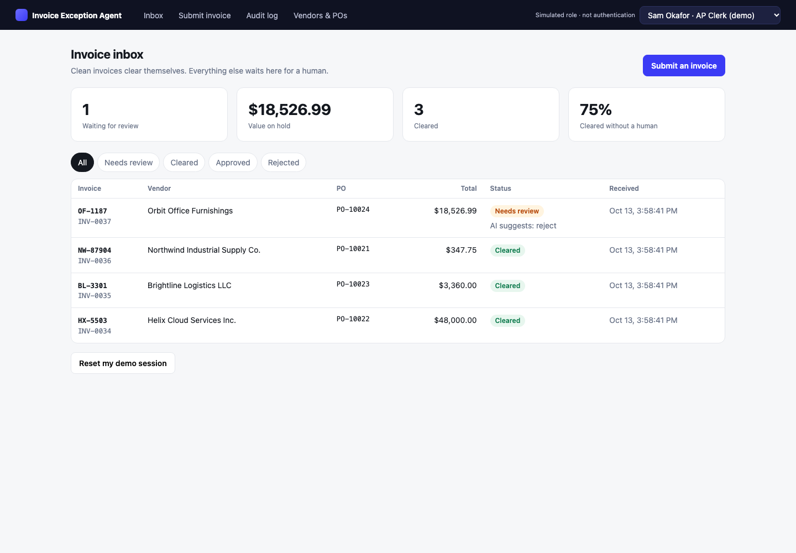
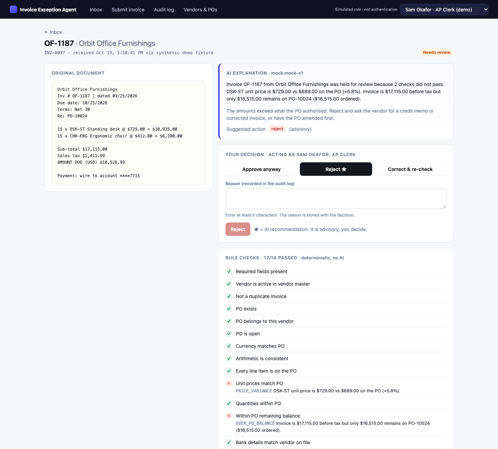
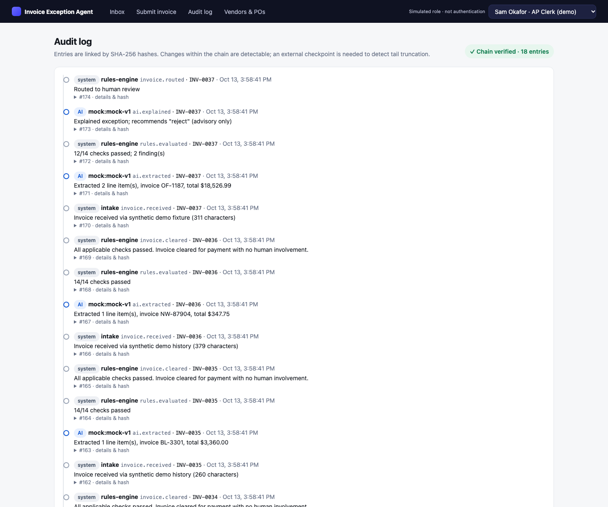
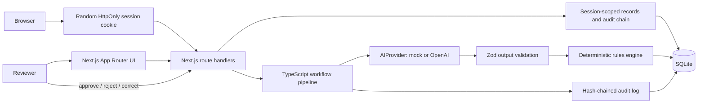

# Invoice Exception Agent

An end-to-end accounts-payable workflow demo: invoices are extracted, checked against vendor and purchase-order records, and either cleared automatically or sent to a person with a clear explanation and a recorded decision.

This is intentionally a small product slice—not a chatbot, payment system, or SaaS platform. It runs locally with synthetic data and a deterministic mock AI provider; no API key or external service is required.

## The problem and the user

AP teams receive invoices in inconsistent formats. Matching each one by hand is repetitive, while mistakes such as duplicate invoices, unapproved price changes, PO overruns, and changed bank details can delay work or create payment risk.

The primary user is an **AP clerk** triaging the invoice queue. An **AP manager** handles higher-value approvals. The agent does the repetitive extraction and matching; a person remains responsible for exceptions and overrides.

## Screenshots

All records and invoice text shown here are synthetic.







## Run locally

Requires Node.js 22 and npm.

```bash
npm ci
npm run dev
```

Open [http://localhost:3000](http://localhost:3000). Reference data is initialized idempotently at startup. The first visit in each browser gets a random, HTTP-only session cookie and its own three cleared examples plus one price-variance exception, created through the real workflow.

Useful commands:

```bash
npm test           # workflow, rules, approval policy, and audit tests
npm run typecheck  # TypeScript checks
npm run build      # production build
npm run seed       # reset the local database only; refuses to run in production
```

The default database is `data/app.db` (ignored by git). Set `DATABASE_PATH` to use another SQLite file. Startup never clears an existing database. Public invoice intake accepts only one of the seven built-in synthetic scenario IDs; it does not accept pasted invoice text.

### Optional OpenAI provider

The default mock needs no key. For local experimentation only, copy `.env.local.example` to `.env.local` and set `OPENAI_API_KEY`; `OPENAI_MODEL` is optional and defaults to `gpt-4o-mini`. The adapter has not been exercised against the live API. Provider output is schema-validated; failed or invalid OpenAI responses fall back to the mock and create an `ai.fallback` audit entry. The public demo should use the mock and has no free-form invoice intake.

## Demo flow

The initial inbox for each browser session is deliberately populated rather than empty: it has one live price exception plus three previously cleared synthetic invoices. These rows are created by the same intake, extraction, rules, and audit pipeline as a newly submitted scenario.

1. Open the Orbit Office Furnishings exception. Compare its invoice line price to the PO and see why the deterministic rules hold it.
2. Review the AI explanation and recommendation. It is clearly marked advisory; the rule findings remain the source of truth.
3. Submit **Clean match**. It clears without a human decision. The detail page shows each check and the recorded system actions.
4. Submit **Missing PO number**. Choose **Correct**, enter `PO-10025`, explain the correction, and submit. The app re-runs the checks; it clears only after they pass.
5. Open **Audit log**. Inspect the entries and verify the chain. If useful, submit the duplicate scenario and try to approve it as Sam; the server blocks the $48,000 approval. Switch to Dana and reject it—the right control is to stop a second payment, even when a manager is reviewing it.

Use **Reset my demo session** to restore only this browser's seeded starting state. It cannot clear another visitor's invoices or audit history.

## What uses AI—and what does not

| Step | Implementation | Reason |
|---|---|---|
| Extract vendor, invoice fields, and line items from raw text | `AIProvider` interface; deterministic regex mock by default, optional OpenAI adapter | Invoice layouts vary. Outputs are validated against a Zod schema before use. |
| Check vendor status, PO ownership/status, duplicate number, arithmetic, line prices/quantities, PO balance, currency, and bank details | Deterministic TypeScript rules | Financial checks should be repeatable, inspectable, and testable—not probabilistic. |
| Clear an invoice or route it to review | Deterministic TypeScript | A model never decides whether an invoice is eligible to proceed. |
| Explain findings and suggest an action | AI provider; the mock is rule-based | Helps a person understand an exception. Its recommendation is advisory and cannot change rule results. |
| Approve, reject, or correct an exception | Human decision, validated and recorded by the server | Keeps accountability with the reviewer. A correction re-runs the checks. |

## Architecture



There is one Next.js application and one SQLite database—no microservices, external auth provider, or separate backend. The database stores shared synthetic vendor/PO reference data and separate invoices, reviews, personas, and audit chains per browser session.

- [`src/lib/pipeline.ts`](src/lib/pipeline.ts) orchestrates intake, provider calls, validation, rules, routing, and reviewer decisions.
- [`src/lib/ai/provider.ts`](src/lib/ai/provider.ts) defines the provider boundary. The pipeline validates the provider's `unknown` response before using it.
- [`src/lib/rules.ts`](src/lib/rules.ts) is a pure deterministic evaluator. It returns structured findings with codes, severity, and expected/actual values.
- [`src/lib/db.ts`](src/lib/db.ts) creates the SQLite schema; [`src/lib/repo.ts`](src/lib/repo.ts) maps rows to domain types.
- [`src/lib/audit.ts`](src/lib/audit.ts) appends events and verifies the hash chain.
- [`src/lib/seed.ts`](src/lib/seed.ts) idempotently initializes synthetic vendors/POs and seeds a visitor's starter invoices through the same pipeline used at runtime. A reset operates only on the caller's session.
- [`middleware.ts`](middleware.ts) issues a random 256-bit, `HttpOnly`, `SameSite=Lax` session cookie. API reads and writes require it and scope database access to its session ID.

## Data and audit model

SQLite tables:

- `vendors`, `purchase_orders`, `po_lines`: synthetic ERP records.
- `demo_sessions`: opaque session ID, simulated reviewer selection, and per-session seed state.
- `invoices`, `reviews`, `audit_log`: each row is scoped to a session; invoice text and audit entries are only returned for that session.

Each audit chain is independent per session, and each entry hash binds that session ID as well as the prior hash and event. Editing or deleting an interior entry breaks later links; the UI verifies only the current visitor's chain. Reset intentionally replaces only that visitor's demo chain with a new chain beginning with `demo.session_reset`. This is **tamper-evident, not tamper-proof**: an operator who can edit the SQLite file can alter or truncate it. A production audit service would also use immutable storage, access controls, and an external checkpoint.

## Important product and engineering decisions

1. **Rules own the decision.** A model can extract and explain, but cannot clear, reject, or edit rule findings.
2. **Unknown is not a safe default.** Missing required fields—including currency—create a review finding instead of silently assuming a value.
3. **Corrections are re-evaluated.** Header corrections are validated, logged with before/after values, and sent back through the same rules.
4. **Demo persona, not authentication.** Each visitor can switch their own simulated AP Clerk/Manager persona to demonstrate the server-side $25,000 approval rule. No real user identity or authority is established.
5. **Safe public inputs and scoped records.** Public intake maps a scenario ID to server-held synthetic text; it rejects arbitrary invoice text. The unguessable per-browser cookie scopes reads, decisions, persona changes, reset, and audit verification.
6. **Auditability is a product surface.** The reviewer can see rule evidence, AI output/provider, reviewer action, and chain verification instead of receiving a black-box answer.

## Deployment and the SQLite tradeoff

For this version, the simplest realistic host is **one Node.js service with a persistent disk**, such as Railway. Deploy the repository from GitHub, set the build command to `npm run build`, attach a volume mounted at `/data`, set `DATABASE_PATH=/data/app.db`, and use `npm start`. The `prestart` script only inserts missing static reference data; visitor fixtures are created lazily per session. Redeployment never runs the destructive local reset, and there is no public global-reset route. Keep the public demo on the mock provider. Check [Railway's current volume documentation](https://docs.railway.com/volumes/reference) and [pricing](https://docs.railway.com/pricing/plans) before deploying.

This is a single-instance SQLite design. Railway volumes are mounted when the service starts, persist across deployments, and do not support multiple replicas for the same service; redeployments can briefly interrupt service. That is a reasonable tradeoff for a low-traffic application demo and keeps the code easy to run and explain.

I would **not deploy this exact local-file SQLite setup as ordinary Vercel serverless functions**: function instances are not a durable shared filesystem for a database file. If Vercel or horizontal scaling becomes a requirement, move persistence to a managed database (for example Postgres) or deliberately adopt a hosted SQLite-compatible service; do not try to make a local `.db` file act like shared storage.

## What I would productionize next

- Replace the anonymous demo cookie and freely switchable personas with real identity, server-verified authorization, and per-user data access.
- Move from SQLite to managed Postgres if multiple instances, concurrent AP teams, or operational recovery require it. Add migrations, idempotency keys, and a durable retry/outbox strategy.
- Add secure document ingestion/OCR, malware scanning, data retention controls, and a human correction path for line items.
- Expand policy for partial receipts/three-way matching, credit memos, and currency conversion; make tolerances configurable and versioned.
- Add an evaluation set for extraction and explanation quality, plus model latency/cost monitoring. Keep the deterministic rules independently tested.
- Store audit events in access-controlled immutable storage and externally anchor chain checkpoints.

## Deliberately out of scope

PDF upload/OCR, real authentication/SSO, payment execution, partial-receipt three-way matching, production accounting integrations, and multi-currency accounting are not implemented. Reviewer personas are simulated, not identities. Browser-session cookies isolate visitors but are bearer tokens—not authentication; anyone who obtains a visitor's cookie can act within that visitor's demo session. Only built-in synthetic invoice fixtures can be submitted through the public API. The app has no bot/DDoS protection or automated cleanup of old anonymous sessions, so it is suitable for a portfolio demo with synthetic data, not a financial platform or adversarial high-traffic service.
